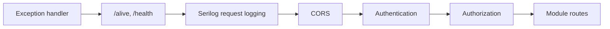

# The host

`Ets.Servers.Api` (`src/hosts/Ets.Servers.Api/Program.cs`) is the composition root and the only HTTP entry point. It
references each module's Infrastructure, Presentation and IntegrationEvents projects, never its Application or
Domain. There is no `IModule` interface and no assembly discovery: with a handful of modules, a list of explicit calls
is easier to read and debug ([ADR-0003](./decisions#model-and-structure)).

## The order of `Program.cs`

The order matters, and each step is there for a reason.

| Step                | What `Program.cs` does                                                                                     | Why                                                                                                                      |
| ------------------- | ---------------------------------------------------------------------------------------------------------- | ------------------------------------------------------------------------------------------------------------------------ |
| 1. Service defaults | `builder.AddServiceDefaults()`: OpenTelemetry, health checks, service discovery, HTTP resilience           | Must come before Serilog so the OpenTelemetry logging provider still sees events ([ADR-0007](./decisions#platform))      |
| 2. Serilog          | `UseSerilog(..., writeToProviders: true)`, console plus Seq when `Seq:ServerUrl` is set                    | Readable structured logs, without cutting OpenTelemetry off                                                              |
| 3. Problem details  | `AddProblemDetails()` and the kernel's `GlobalExceptionHandler`                                            | One error shape for every unhandled exception                                                                            |
| 4. OpenAPI          | One document per module (`deals`, `users`) plus `host`, each with `ShouldInclude` pinned to its group name | Generated clients follow the module boundary; a route never leaks into every document                                    |
| 5. CORS             | A default policy from `Cors:Origins`                                                                       | Empty means no browser origin may call the API                                                                           |
| 6. Authentication   | `AddKeycloakAuthentication`: JWT bearer with issuer and audience validated explicitly                      | The host is a pure resource server ([Security](./security))                                                              |
| 7. Authorization    | `AddCoreAuthorization([.. DealsPermissions.All, .. UsersPermissions.All])`                                 | One declared policy per permission, from each module's published catalogue                                               |
| 8. Kernel           | `AddCoreApplication` (clock, holiday calendar), `AddCoreInfrastructure` (id generator, caller)             | Registered before the modules, whose contexts use them                                                                   |
| 9. Data source      | `AddNpgsqlDataSource("ets")`                                                                               | One PostgreSQL data source, shared by the Marten stores, with its health check and telemetry                             |
| 10. Modules         | Per module, `Add{Module}Module(configuration)` then `Add{Module}Endpoints(policies)`                       | Services from Infrastructure, endpoint registrations from Presentation                                                   |
| 11. CQRS pipeline   | `AddMediatorPipeline()`, **once, after every module**                                                      | Decorators are open-generic and wrap whatever is registered at that moment ([ADR-0008](./decisions#model-and-structure)) |

## Three lines per module

```csharp
builder.Services
    .AddDealsModule(builder.Configuration)                  // Infrastructure: use cases and adapters
    .AddDealsEndpoints(new DealsAuthorizationPolicies(     // Presentation: endpoint registrations
        DealsPermissions.Read,
        DealsPermissions.Capture,
        DealsPermissions.Confirm));

app.MapDealsModule();                                       // Presentation: routes under /api/deals
```

The composition root is split in two because no single project may see both the adapters and the endpoints: that
would need `Infrastructure → Presentation` or the reverse, and both are forbidden. The host passes policy **names**
into `Add{Module}Endpoints`, so a module's Presentation never imports an authorization constants class; which
permission guards which route class is the host's call.

## The request pipeline



- **Request logging comes after the exception handler**, so the log records the status the client actually
  received.
- **CORS comes before authentication**: a preflight carries no credentials and must not be challenged.
- **The health probes are anonymous**: an orchestrator cannot present a bearer token.
- In Development only, the host maps the OpenAPI documents and the **Scalar** reference UI at `/scalar/`, and
  redirects `/` there. Scalar does not discover documents: every document added with `AddOpenApi` must also be named
  in `MapScalarApiReference`.

## The host's own routes

Besides the module groups, the host maps one route of its own, `GET /api/me`, in the `host` OpenAPI document. It
returns the caller's identity id, name, email and **permissions**, which is how the SPA learns what to show. It grants
nothing: every module endpoint still enforces its own policy.

## Configuration

Configuration is the standard .NET chain, one `IConfiguration` for the host, with a **named section per adapter**
bound to an options class that declares `public const string SectionName` and validates with
`.Validate(...).ValidateOnStart()` ([ADR-0005](./decisions#model-and-structure)). There are no per-module files and
no configuration server. Connection strings come from Aspire as environment variables, and secrets never live in
`appsettings*.json`.

The sections bound today, such as `Keycloak`, `Seq`, `Holidays` and `Users:DevelopmentSeed`, are listed with their
owners in `src/CONTEXT.md` under _Configuration_.

## Local orchestration

`src/aspire/Ets.Aspire.AppHost` starts PostgreSQL (database `ets`), Redis, RabbitMQ, Keycloak (with the realm in
`Realms/` imported on first start) and Seq as persistent containers, then the API host, and passes their locations
down as environment variables. Aspire is **local orchestration only**: a deployed host has no AppHost and reads the
same keys from its own environment ([ADR-0007](./decisions#platform)). Running it is covered in
[Build and run](../getting-started/build-and-run).
