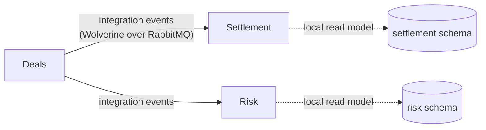

# Architecture

This section is a developer's tour of how ETS is built: the shape of the system, the rules that keep its modules
apart, and how one request travels through it. It summarises the design documents in the repository and links to
them; it does not replace them.

::: info Where the rules live
The source of truth for _why_ ETS looks the way it does is in the repository: `docs/architecture/architecture.md`,
the shared kernel contract in `docs/architecture/kernel.md`, the decision records in `docs/architecture/adr/`, and
the domain glossary, invariants and known gaps in `src/CONTEXT.md`. When this site and those documents seem to
disagree, they win.
:::

## A modular monolith

ETS is a **.NET 10 modular monolith**: one deployable API host, `Ets.Servers.Api`, composed of modules that each own
one bounded context of the trading domain. Modules share a process and a deployment, but not their internals. The
boundaries are enforced by project references and by architecture tests, not by the network.

It is built **model first**. The domain is designed in Context Mapper (`modelling/ddd/**/*.cml`), and the C# domain
code is a reflection of that model. When the CML and the C# disagree, the CML wins
([ADR-0009](./decisions#model-and-structure)).

<iframe src="/diagrams/archify/ets-host.html" title="ETS host composition and runtime dependencies" loading="lazy" style="width: 100%; height: 640px; border: 1px solid var(--vp-c-divider); border-radius: 8px"></iframe>

[Open the diagram full screen](/diagrams/archify/ets-host.html){target="_blank"}

The diagram shows what the host composes today: the Deals and Users modules in one process, Keycloak for sign-in,
one PostgreSQL database with a schema per module, and Serilog and OpenTelemetry for telemetry.

## Bounded contexts and modules

Each CML `BoundedContext` maps to one module. The architecture names the contexts the product scope implies; the CML
decides the final set.

| Bounded context                   | Module                       | Kind              | Owns                                                                                | In the CML and code |
| --------------------------------- | ---------------------------- | ----------------- | ----------------------------------------------------------------------------------- | ------------------- |
| `SharedContext`                   | `src/core/Ets.Core.Domain`   | Shared kernel     | Money, amounts and volumes with units, terms, NEM regions, holidays, identifiers    | Yes                 |
| `DealCaptureContext`              | `Ets.Modules.Deals`          | Core              | Deal capture and lifecycle for ASX futures and options, OTC swaps, caps and options | Yes (ASX futures)   |
| `IdentityContext`                 | `Ets.Modules.Users`          | Generic           | Users, roles and the permissions roles grant                                        | Yes                 |
| `SettlementContext`               | `Ets.Modules.Settlement`     | Core / supporting | Settlement against spot, invoicing data, ASX clearing reconciliation                | No                  |
| `RiskContext`                     | `Ets.Modules.Risk`           | Core              | Positions, mark-to-market, exposure and limits                                      | No                  |
| _candidate_ `MarketDataContext`   | `Ets.Modules.MarketData`     | Supporting        | Forward curves, ASX settlement prices, AEMO spot prices                             | No                  |
| _candidate_ `CounterpartyContext` | `Ets.Modules.Counterparties` | Supporting        | Counterparties, ISDA and credit terms, clearing participants                        | No                  |

The architecture tests already list Settlement, Risk, MarketData and Counterparties by namespace, so the module
isolation rules apply to them from their first line of code. The deal capture vocabulary (deal, ASX product, product
code, contract size, term) is in `modelling/ddd/deals/ubiquitous.md`.

## Deals → Settlement → Risk

The natural flow of the business is one way: a deal is captured and confirmed in Deals, then settled in Settlement
and valued in Risk. Modules never read each other's tables. A confirmed deal is published by Deals as a versioned
**integration event** and consumed by Settlement and Risk into their own read models.

This flow is the decided design ([ADR-0004](./decisions#model-and-structure),
[ADR-0011](./decisions#platform)). Only Deals exists of the three today, and it publishes no integration event;
see [Messaging, caching and scheduling](./messaging-caching-scheduling) for the current shape.

## The platform stack

Each line has an ADR; the [Decision records](./decisions) page summarises them all.

| Concern            | Choice                                                                                       | ADR        |
| ------------------ | -------------------------------------------------------------------------------------------- | ---------- |
| Structure          | Five projects per module, IntegrationEvents as the public API, three host lines per module   | 0001–0004  |
| Configuration      | Named sections of the host's configuration, validated at startup                             | 0005       |
| Identity and authz | Keycloak JWTs; permissions owned by the Users module, one declared policy per permission     | 0006       |
| Orchestration      | .NET Aspire runs PostgreSQL, Redis, RabbitMQ, Keycloak and Seq locally                       | 0007       |
| In-process CQRS    | The kernel's own `ICommand` / `IQuery` handlers with Scrutor decorators, no MediatR          | 0008       |
| Database and ORM   | PostgreSQL, schema per module; EF Core with snake_case; Dapper allowed for heavy reads       | 0010       |
| Event sourcing     | Marten for the Deals and Settlement aggregates                                               | 0013       |
| Messaging          | Wolverine over RabbitMQ for module-to-module traffic, with an outbox and inbox in PostgreSQL | 0011       |
| Caching            | FusionCache (memory L1, Redis L2 and backplane) behind `HybridCache`                         | 0012       |
| Ids                | Guid v7 generated by the domain, plus human-readable business references                     | 0014       |
| Scheduling         | Quartz.NET jobs that send Wolverine commands                                                 | 0015       |
| Observability      | Serilog to Seq; OpenTelemetry to the Aspire dashboard; `/alive` and `/health`                | 0016       |
| Tests              | xUnit v3, Shouldly, Testcontainers, ArchUnitNET                                              | 0017, 0018 |
| Frontend           | Vue 3 + TypeScript + Vite SPA in a pnpm workspace; Keycloak via `oidc-client-ts`             | —          |

## In this section

| Page                                                                | What it covers                                                           |
| ------------------------------------------------------------------- | ------------------------------------------------------------------------ |
| [Modules and layers](./modules)                                     | The five projects of a module, the reference graph and the public API    |
| [The host](./host)                                                  | How `Ets.Servers.Api` composes the modules, in what order and why        |
| [The shared kernel](./kernel)                                       | `Result`, CQRS without MediatR, enumerations, ids, references and events |
| [A request, end to end](./request-lifecycle)                        | One deal capture traced from the SPA to the event store                  |
| [Persistence and event sourcing](./persistence)                     | Schemas, EF Core conventions, Marten streams and the unit of work        |
| [Messaging, caching and scheduling](./messaging-caching-scheduling) | Wolverine, FusionCache and Quartz: the decisions and the current shape   |
| [Security](./security)                                              | Keycloak, permission claims and declared policies                        |
| [Observability](./observability)                                    | Logs, traces, metrics and health checks                                  |
| [Testing](./testing)                                                | Unit and architecture tests, and what each one guards                    |
| [Decision records](./decisions)                                     | Every ADR in one line, grouped by topic                                  |
