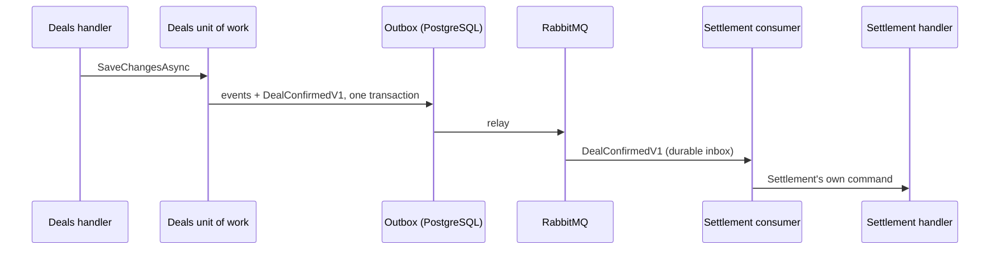

# Messaging, caching and scheduling

Three platform decisions shape how modules talk to each other, how reads are kept fast and how time-based work runs.
All three are decided and recorded in ADRs; none is wired into the host today. This page explains each decision and
then the current shape, so you can tell the decided design from the code as it stands.

::: warning Current shape
The AppHost starts Redis and RabbitMQ and passes their connection strings to the API, but the host registers no
Redis or RabbitMQ client, and neither Wolverine nor FusionCache is referenced by any project. Quartz is referenced
only to evaluate cron expressions. `src/CONTEXT.md` records these under _Known gaps_.
:::

## Messaging: Wolverine over RabbitMQ

**Decision** ([ADR-0011](./decisions#platform)): cross-module communication is asynchronous **integration events**,
carried by Wolverine over RabbitMQ for **all** module-to-module traffic, with Wolverine's transactional outbox and
durable inbox in PostgreSQL. In-process command and query handling stays on the kernel's own CQRS: Wolverine is the
bus, not the mediator.

The rules that follow:

- **Contracts are plain versioned records** in the producer's IntegrationEvents project (`DealConfirmedV1`), with no
  Wolverine or kernel types.
- **Domain events stay inside the module.** The unit of work maps the relevant ones to integration events and
  publishes them through the outbox in the same transaction as the state change: `IDbContextOutbox<TContext>` for EF
  Core, the Marten outbox integration for event-sourced modules.
- **Consumers live in the consuming module's Infrastructure** (`Infrastructure/Messaging`). A consumer translates the
  integration event into the module's own command and calls the kernel handler. **Domain and Application never
  reference Wolverine**, and an architecture test enforces it.
- **Conventional handler discovery is off**, because kernel handlers also end in `Handler`. Each module's
  Infrastructure assembly is included explicitly, and local routing is disabled so modules talk only through the
  broker.
- **Idempotency comes from the durable inbox**: a message is processed once per destination. Multi-step workflows
  are Wolverine sagas in the module that owns the workflow.
- RabbitMQ rather than in-process queues, so work can be spread across host instances and separate workers, and a
  module can later be extracted by configuration.

**Today:** the Deals and Users units of work save their own state only, and no module declares an integration event.

## Caching: FusionCache behind HybridCache

**Decision** ([ADR-0012](./decisions#platform)): FusionCache with an in-memory L1, Redis as the L2 and the Redis
backplane, so every host instance drops its L1 copy when an entry changes. Code depends on the `HybridCache`
abstraction, with FusionCache registered as its implementation.

- **Cache only what may be stale for a stated period**: market data, reference data, permission sets. Deal state and
  positions are never served from cache to a write path, and aggregates are never cached.
- **Fail-safe limits are declared per entry type**, next to the key definition. For prices used in valuation the stale
  age must be visible to the caller.
- **Keys are module-namespaced constants** in the owning module (`deals:…`, `marketdata:curve:{region}:{date}`).
- **Redis being unavailable is a readiness failure**, not a silent fallback to memory.
- Cached values are immutable DTOs serialised with System.Text.Json.

**Today:** nothing is cached. The most visible effect is that the Users module's permission claims are looked up in
the `users` schema on every authenticated request ([Security](./security)).

## Scheduling: Quartz.NET sends Wolverine commands

**Decision** ([ADR-0015](./decisions#platform)): time-based work, such as end-of-day mark-to-market after ASX
settlement prices publish, settlement runs and market-data pulls, is triggered by Quartz.NET with a clustered
PostgreSQL job store. Quartz brings cron triggers, **holiday calendars** for NEM and ASX trading days, and clustering
so a job fires once across instances.

- **A job does one thing: send a Wolverine command.** Retries, idempotency and tracing then come from the messaging
  pipeline instead of being rebuilt in every job.
- **Every scheduled command carries its business date**, so a rerun or catch-up is deterministic.
- Jobs live in the owning module's `Infrastructure/Scheduling`; schedules are configuration (an options class with a
  `SectionName`), not code constants.
- Outbox polling is not a Quartz job: Wolverine's durability agent handles it.

**Today:** there are no jobs. Quartz is used for one thing: `QuartzCronScheduleEvaluator` in `Ets.Core.Infrastructure`
evaluates the kernel's `CronSchedule` value object, which accepts only Quartz-shaped expressions. The evaluation lives
in Infrastructure because the architecture tests keep Quartz out of Domain and Application.
