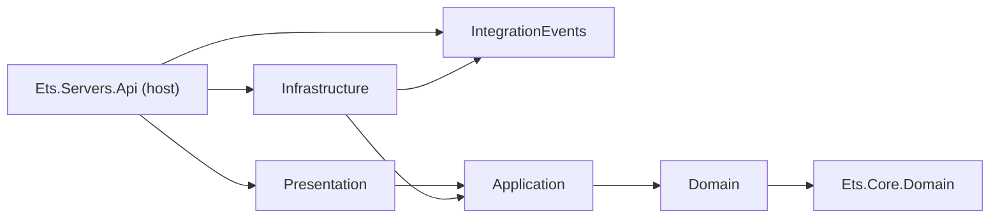
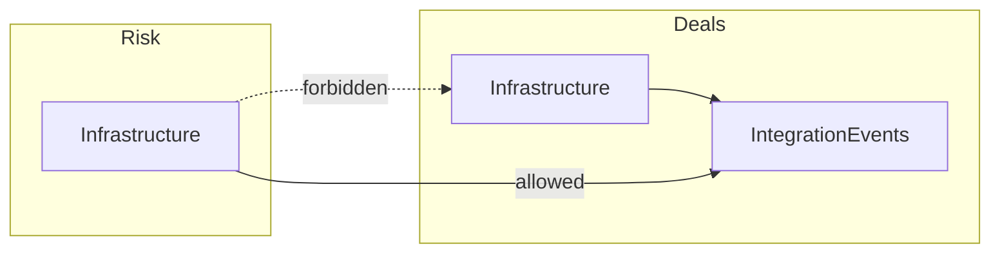

# Modules and layers

A module owns one bounded context. Its boundaries are made of assemblies, not folders: every module is five
projects with a fixed reference graph, and the architecture tests fail when a reference breaks
it. The reasoning is in ADR-0001 and ADR-0004 (`docs/architecture/adr/`).

## Five projects per module

| Project                                  | Owns                                                                                         | References                                                |
| ---------------------------------------- | -------------------------------------------------------------------------------------------- | --------------------------------------------------------- |
| `Ets.Modules.{Module}.Domain`            | Aggregates, entities, value objects, domain events, repository ports                         | `Ets.Core.Domain`                                         |
| `Ets.Modules.{Module}.Application`       | Commands, queries, handlers, validators, application ports                                   | Domain                                                    |
| `Ets.Modules.{Module}.Infrastructure`    | Adapters (persistence, external systems); the **service-side** composition root              | Application, IntegrationEvents, `Ets.Core.Infrastructure` |
| `Ets.Modules.{Module}.Presentation`      | One endpoint class per slice, request and response DTOs; the **route-side** composition root | Application, `Ets.Core.Presentation`                      |
| `Ets.Modules.{Module}.IntegrationEvents` | The module's public API: integration events, snapshots, permission names                     | nothing                                                   |



::: danger Forbidden references
`Application → Infrastructure`, `Presentation → Infrastructure` and `Infrastructure → Presentation` are forbidden, as
is a Domain that depends on EF Core or ASP.NET Core, or on Wolverine, Marten, Quartz, FusionCache or Npgsql. The host
never references a module's Application or Domain. All of these fail `tests/architecture/EtsArchitectureTests`.
:::

Each layer project has an `AssemblyReference` class: a compile-time handle that DI scanning and the architecture
tests use instead of assembly-name strings.

## Inside a module

The Deals module shows the layout every module follows. A use case is a **vertical slice**: its command, handler and
validator share one folder in Application, and its endpoint sits in the matching folder in Presentation.

```text
src/modules/deals/
  Ets.Modules.Deals.Domain/
    Models/          ExchangeDeal, AsxFuturesDeal
    ValueObjects/    DealId, ProductCode, TradeDirection (+ TradeDirectionValue), ...
    Events/          AsxFuturesDealCaptured
    Repositories/    IExchangeDealRepository, IDealsUnitOfWork
    Services/        IAsxProductCatalogue
  Ets.Modules.Deals.Application/
    Deals/CaptureAsxFuturesDeal/   ...Command, ...CommandHandler, ...CommandValidator
  Ets.Modules.Deals.Infrastructure/
    DealsModule.cs   AddDealsModule
    EventStore/      Marten store, session, repository, unit of work, event JSON
    Persistence/     DealsDbContext, Configuration/DbAsxProductMap, Entities/DbAsxProduct, Migrations/
    Products/        AsxProductCatalogue
  Ets.Modules.Deals.Presentation/
    Deals/CaptureAsxFuturesDeal.cs  one IEndpoint per slice
    DealsEndpoints.cs, DealsAuthorizationPolicies.cs, OpenApiDocuments.cs, Tags.cs
  Ets.Modules.Deals.IntegrationEvents/
    Authorization/DealsPermissions.cs
```

The full template, including `Messaging/` and `Scheduling/` folders for modules that consume events or run jobs, is in
`docs/architecture/architecture.md` under _Inside a module_.

## IntegrationEvents is the public API

`Ets.Modules.{Module}.IntegrationEvents` is the **only** project another module, or the host, may reference. It
holds:

- **Integration event contracts**: plain, versioned records (`DealConfirmedV1`) that other modules consume.
- **Read-side snapshots** another context needs instead of the aggregate.
- **Permission names** (`DealsPermissions`, `UsersPermissions`), because which permissions a module defines is part
  of its contract.
- **Published queries** another module or the host may call. `IUserPermissionsQuery` in
  `Ets.Modules.Users.IntegrationEvents` is the one example: the host's claims transformation asks it for a caller's
  permissions without reading the `users` schema.

It stays reference-light, ideally referencing nothing: every dependency it takes is inherited by each consumer, so a
`Result` or `Enumeration<>` in a contract would drag the kernel into every other module.



## Rules that keep modules apart

- **A module never reads another module's tables.** Cross-module reads go through a local read model, built from
  integration events; cross-module writes go through integration events.
- **Endpoints are one `internal sealed class : IEndpoint` per slice.** `AddEndpoints(assembly)` discovers them and
  `MapEndpoints(assembly)` maps them into the module's own route group (`/api/deals`, `/api/users`). They are
  resolved from the root provider, so they have a **parameterless constructor**; per-request services, such as the
  command handler, are parameters of the route delegate ([ADR-0002](./decisions#model-and-structure)).
- **Each endpoint states its own permission policy.** The route group carries none, so a new write route cannot
  inherit read authorization. See [Security](./security).
- **One OpenAPI document per module.** The group sets its document name once, and the host pins each document to its
  own group name, so a route is published only into the document it names. See [The host](./host).

## Adding a module

The steps, from `CLAUDE.md`, in the order you will meet them:

1. Model the bounded context in CML under `modelling/ddd/{context}/`, with its `ubiquitous.md`.
2. Create the five projects, add `AssemblyReference.cs` to each, and wire the reference graph above.
3. Add `{Module}Module.cs` (Infrastructure), `{Module}Endpoints.cs`, `OpenApiDocuments.cs` and `Tags.cs`
   (Presentation), and `{Module}Permissions.cs` (IntegrationEvents).
4. Add the module's three lines to `Program.cs`, its permissions to `AddCoreAuthorization`, and its OpenAPI document
   to both `AddOpenApi` and `MapScalarApiReference`.
5. Include its Infrastructure assembly in Wolverine discovery and enrol its DbContext or Marten store for the outbox,
   once the host runs Wolverine (see [Messaging, caching and scheduling](./messaging-caching-scheduling)).
6. Add the module to the architecture tests' module list, `tests/architecture/EtsArchitectureTests/Abstractions/EtsModules.cs`.
7. Mirror its permissions in the SPA's `src/clients/apps/ets/src/lib/permissions.ts`.
