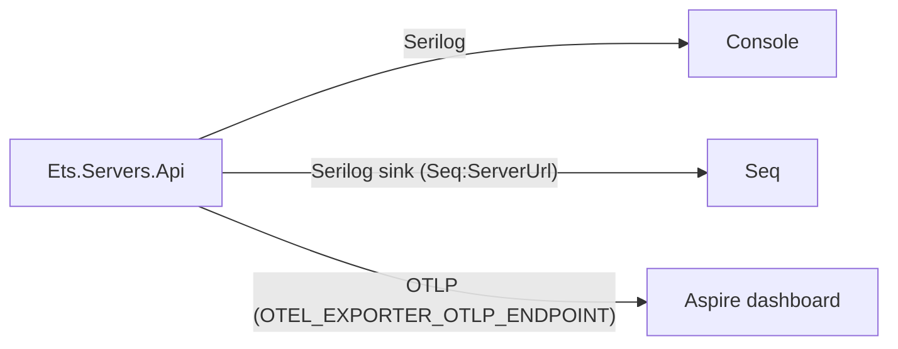

# Observability

ETS writes structured logs with **Serilog** and traces and metrics with **OpenTelemetry**. Locally, logs go to the
console and Seq, and OpenTelemetry goes to the Aspire dashboard. Health is two probes, `/alive` and `/health`. The
decision is ADR-0016; the wiring is in `src/aspire/Ets.Aspire.ServiceDefaults` and the host's `Program.cs`.

## Logs

- **Serilog is configured after `AddServiceDefaults()`, with `writeToProviders: true`**, so the OpenTelemetry logging
  provider still receives every event. Serilog gives readable structured logs; OpenTelemetry feeds the dashboard.
- The minimum level is Information, with `Microsoft.AspNetCore` overridden to Warning. Events are enriched from the
  log context.
- **Seq is optional.** The `Seq` section (`ServerUrl`, `ApiKey`) adds the Seq sink; without it, logs go to the console
  only. The AppHost supplies `Seq:ServerUrl`.
- **Request logging** (`UseSerilogRequestLogging`) runs after the exception handler, so it records the status the
  client actually received.
- **The CQRS logging decorator** pushes `Module` and `RequestName` into the log context for every command and query,
  and tags the current trace with `ets.module`, `ets.request` and, on failure, `ets.error.code`. The module name comes
  from the request's namespace.
- **Log identifiers, not payloads.** Never log message bodies or commands containing prices, volumes or counterparty
  data at Information level.

## Traces and metrics

`AddServiceDefaults()` registers OpenTelemetry with ASP.NET Core and HttpClient tracing and metrics, runtime metrics,
and the host's own activity source. The health probes are filtered out of traces so they do not drown real traffic.
Aspire's `AddNpgsqlDataSource` adds PostgreSQL tracing and metrics. The OTLP exporter is enabled only when
`OTEL_EXPORTER_OTLP_ENDPOINT` is set, which the AppHost does locally; a deployment points it at Seq, which stores
traces as well as logs, so one tool answers "what happened to this deal" from a trace id.

By design, Wolverine, Marten and Quartz add their own trace sources, and W3C trace context propagates across RabbitMQ,
so a deal confirmation and the settlement and risk work it triggers form one trace. Today the host adds none of those
sources: Marten is in use but untraced, and Wolverine and Quartz jobs are not wired in
([Messaging, caching and scheduling](./messaging-caching-scheduling)).

## Health checks

| Probe     | Includes                                      | Used for                                                                |
| --------- | --------------------------------------------- | ----------------------------------------------------------------------- |
| `/alive`  | Only checks tagged `live`: the process itself | Liveness. A dependency outage must not get the process restarted        |
| `/health` | Every check, including PostgreSQL             | Readiness. The instance takes traffic only when its dependencies are up |

Both probes are anonymous, because an orchestrator cannot present a bearer token, and both have a five-second
timeout and a ten-second output cache. Add a module's checks to the same health-check builder; never build a second
pipeline. `/health` checks the process and PostgreSQL only, because the host registers no Redis or RabbitMQ client
(`src/CONTEXT.md`, _Known gaps_).

## Where to look locally

| Tool             | For                                                         |
| ---------------- | ----------------------------------------------------------- |
| Aspire dashboard | Resources, console output, structured logs, traces, metrics |
| Seq              | Searchable structured logs from Serilog                     |
| RabbitMQ UI      | Linked from the dashboard (management plugin)               |

The dashboard URL is printed when the AppHost starts; see [Build and run](../getting-started/build-and-run).
