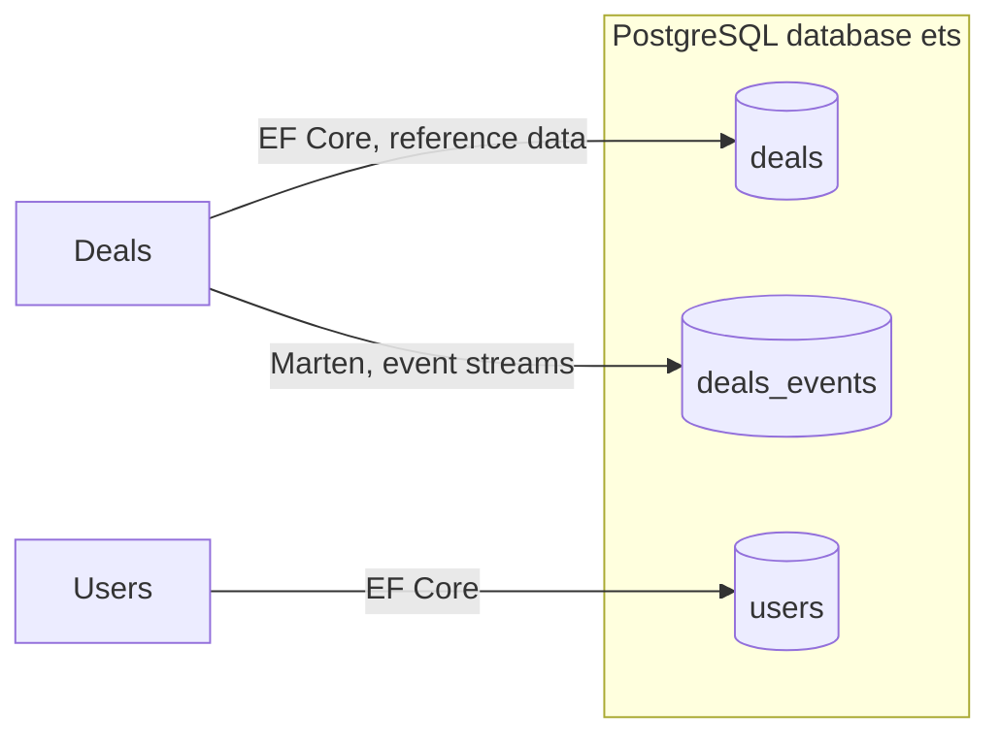
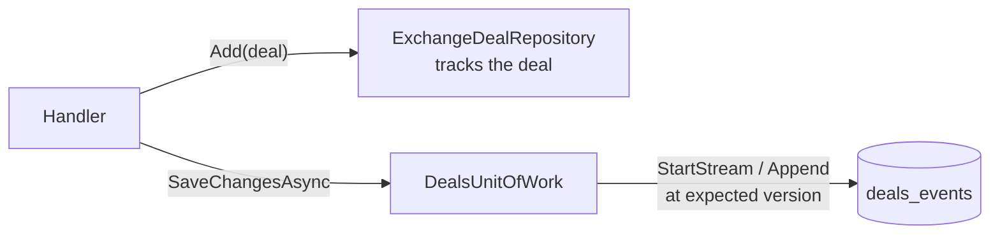

# Persistence and event sourcing

ETS has one PostgreSQL database, `ets`, and two persistence models in it. Most modules keep state in EF Core; the
Deals and Settlement aggregates are **event sourced** in Marten. Every module owns its own schema, and no module reads
another's tables. The conventions are in ADR-0010 and ADR-0013; running migrations is covered in
[The database](../getting-started/database).

## A schema per module

| Schema         | Owner and technology              | Holds                                                     |
| -------------- | --------------------------------- | --------------------------------------------------------- |
| `deals`        | Deals, EF Core (`DealsDbContext`) | Reference data the write side looks up: `asx_products`    |
| `deals_events` | Deals, Marten (`IDealsStore`)     | One event stream per deal                                 |
| `users`        | Users, EF Core (`UsersDbContext`) | Users, roles, the permissions roles grant and assignments |

Each EF Core context keeps its migrations history table in its own schema, and each Marten store has its own schema
separate from the module's EF Core one, so either can later move to its own database. There are no cross-module joins
or foreign keys.

## Choosing the model

| Module                                  | Model                                           | Why                                                                                                                               |
| --------------------------------------- | ----------------------------------------------- | --------------------------------------------------------------------------------------------------------------------------------- |
| Deals, Settlement                       | Marten event store, plus read-model projections | A deal's and a settlement's life is a sequence of facts, and "what did this deal look like at 16:00 yesterday" must be answerable |
| Risk, Users, MarketData, Counterparties | EF Core                                         | State-based data with no audit-by-replay requirement                                                                              |

A module **never mixes both models for one aggregate**. Deals also has an EF Core context, but only for lookup data
such as the ASX product catalogue: a deal is never a row in `deals`.

PostgreSQL has no system-versioned temporal tables, so history comes from event streams, or from an explicit
append-only amendment table where an EF Core aggregate needs one. Triggers into history tables were rejected because
they record rows, not intent.

## Event sourcing with Marten

- **One ancillary Marten store per event-sourced module** (`IDealsStore`), registered with `AddMartenStore`, on the
  host's shared `NpgsqlDataSource`.
- **Stream id = aggregate id.** A deal's Guid v7 `DealId` is its stream id, and its captured event is always the first
  event of its stream.
- **Aggregates rebuild by applying events.** `EventSourcedAggregate<TId>` dispatches each event to the aggregate's
  `Apply(TEvent)` method, both when loading history and when behaviour raises a new event.
- **The repository only tracks; the unit of work appends.** `ExchangeDealRepository.Add` tracks the deal in the
  request's session. `DealsUnitOfWork.SaveChangesAsync` starts a stream for a new deal, or appends to an existing one
  expecting the version it was loaded at, then saves once. A version clash is returned as a `Conflict` result
  (`deal.concurrency-conflict`), not thrown.
- **Events are stored in their value objects' plain forms.** `DealsEventJson` serialises an enumeration as its
  `*Value` member name, `Amount` and `Volume` as their unrounded value and unit, and a `ProductCode` as its code. A
  value object's internals can change freely, but a stored form cannot change without a new event type.
- **Event types are versioned.** An event type is never changed after release; a new shape is a new type plus an
  upcaster. Keep personal data in events minimal (identity ids, not names), because events are immutable.

## EF Core conventions

Every EF Core context derives from the kernel's `DbContextBase` and follows the same rules:

- **snake_case** names via `UseSnakeCaseNamingConvention()`; C# stays PascalCase.
- `OnModelCreating` sets the module's default schema and calls `ApplyAllConfigurations<TContext>()`, which discovers
  **one `IEntityTypeConfiguration` per entity**, named `{Entity}Map`, under the context's `Persistence/Configuration`.
- **Rows are `Db` + entity name** (`DbAsxProduct`) when the persistence shape differs from the domain type; otherwise
  the domain type is mapped directly, as Users does for `Role` and `User`.
- **Enums are stored as their member name**, by a convention on the context (`HaveConversion<string>()`), never per
  property and never as an ordinal.
- **Every column has an explicit `HasColumnOrder`**: key 1, the rest in tens, audit columns in the 9900s.
- **Table-per-hierarchy mirrors the domain hierarchy**, with the discriminator as shadow state.
- **Repositories reconcile child collections by id**: insert new, update existing, delete missing. Never clear and
  rebuild, which re-keys every row.
- `DbContextBase` stamps `IAudited` entities and turns deletes of `ISoftDelete` entities into a flag. **`ISoftDelete`
  needs a global query filter before any entity adopts it.**
- `timestamptz` for every instant, stored in UTC; market-local dates are `date`, never midnight timestamps. `jsonb`
  only for payloads no query filters on.
- `Persistence/Migrations` is EF-generated and **never hand-edited**.

## Reads

Query handlers default to EF Core **no-tracking projections** (`AsNoTracking().Select(...)`) straight into response
DTOs. Dapper over the shared `NpgsqlDataSource` is allowed for reporting and risk queries where hand-written SQL is
clearer or materially faster, and that SQL stays inside the owning module's schema. Event-sourced modules answer
queries from Marten projections: inline for state the write side needs at once, async for query and reporting views.

## The unit of work

Each module declares its own unit of work interface deriving from the kernel's `IUnitOfWork` (`IDealsUnitOfWork`,
`IUsersUnitOfWork`), so a handler cannot be given another module's. `SaveChangesAsync` returns a `Result`, with a
concurrency or uniqueness clash as a `Conflict`. By design it is also where domain events become integration events
and enter the Wolverine outbox in the same transaction; neither unit of work does that today, as
[Messaging, caching and scheduling](./messaging-caching-scheduling) explains.

::: info Current shape
The EF Core contexts read their connection string themselves with `UseNpgsql`, so they hold a connection pool
separate from the shared data source the Marten store uses. The `deals_events` schema is created by Marten on first
use, and there are no deal projections. `src/CONTEXT.md` lists these and the other gaps under _Known gaps_.
:::
