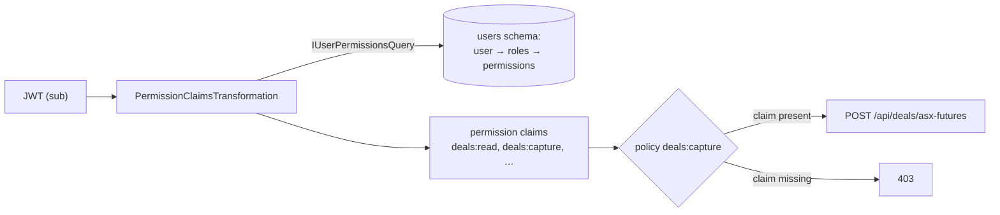

# Security

Keycloak decides **who** a caller is; ETS decides **what they may do**. Endpoints require **permissions**, never
roles, and which roles grant which permissions is data in the Users module that can change without a deployment. The
decision is ADR-0006; this page shows how the pieces fit.

## The pieces

| Piece                 | Where                                                    | Role                                                                             |
| --------------------- | -------------------------------------------------------- | -------------------------------------------------------------------------------- |
| Keycloak realm `ets`  | `src/aspire/Ets.Aspire.AppHost/Realms/`                  | Credentials and sessions; issues JWTs for the `ets-api` audience                 |
| SPA sign-in           | `src/clients/apps/ets/src/auth/oidc.ts`                  | Authorization code + PKCE with the public client `ets-web`, via `oidc-client-ts` |
| JWT validation        | `src/hosts/Ets.Servers.Api/Authentication`               | Validates issuer and audience explicitly; the host holds no secret               |
| Permission catalogues | `{Module}Permissions` in each module's IntegrationEvents | The permissions a module declares, such as `deals:capture`                       |
| Roles and grants      | The Users module, schema `users`                         | Roles are named sets of permissions; users hold roles                            |
| Claims transformation | `PermissionClaimsTransformation` (Users Infrastructure)  | Adds a `permission` claim for each permission the caller's roles grant           |
| Policies              | `AddCoreAuthorization` (`Ets.Core.Infrastructure`)       | One declared policy per permission, requiring that claim                         |
| `GET /api/me`         | The host                                                 | Tells the SPA the caller's permissions                                           |



## Permissions

Each module declares its permissions in its public API, so the host and other modules can name them without
referencing the module's internals:

```csharp
public static class DealsPermissions
{
    public const string Read = "deals:read";
    public const string Capture = "deals:capture";
    public const string Confirm = "deals:confirm";

    public static IReadOnlyList<string> All { get; } = [Read, Capture, Confirm];
}
```

A permission is `module:action`, lower case with a kebab-case action. Capture and confirm are separate permissions
because they are separate duties: the trader who captures a deal must not be the person who confirms it with the
counterparty.

| Module | Permissions                                    |
| ------ | ---------------------------------------------- |
| Deals  | `deals:read`, `deals:capture`, `deals:confirm` |
| Users  | `users:read`, `users:manage`                   |

## Declared policies, not a dynamic provider

The host passes every module's `All` list to `AddCoreAuthorization`, which registers **one policy per permission**:
an authenticated caller carrying a `permission` claim with that exact value. There is no dynamic policy provider,
because a synthesised policy turns a typo into a route nobody, or everybody, can call. The declared set can be listed
at startup.

Each endpoint names its own policy, from the policy names the host passed to `Add{Module}Endpoints`:

```csharp
app.MapPost("/asx-futures", HandleAsync)
    .RequirePolicy(app.Policies().Capture)
```

The module's route group carries no policy, so a new write route cannot silently inherit read authorization, and
`RequirePolicy` rejects an empty policy name. **There is no switch that disables authorization.**

## Permission claims

`PermissionClaimsTransformation` runs after authentication on every request. It reads the token's `sub` (the Keycloak
subject, stored as the user's identity id), asks `IUserPermissionsQuery` for the permissions of every role that user
holds, and adds them on a separate identity marked `ets-permissions`, so a principal is enriched once however often
authentication runs. A caller with no registered user gets no permissions, and every policy denies them.

The Users module manages roles and users under `/api/users`: create roles, grant and revoke permissions, register
users, and assign and unassign roles. In Development, `Users:DevelopmentSeed` in the host's
`appsettings.Development.json` creates `Trader`, `Operations` and `Administrator` roles and gives the local `trader`
user the first and last.

## The SPA

The SPA gets permissions from `GET /api/me`, **never by decoding the token**. Route `meta.permission` and
`session.can()` only shape the user interface; every endpoint still enforces its own policy. Keep
`src/clients/apps/ets/src/lib/permissions.ts` in step with the modules' `*Permissions.cs` catalogues.

## Details that are easy to get wrong

- **Validate the audience.** Keycloak's default audience is `account`; the realm's clients carry an audience mapper
  that adds `ets-api`, and the host rejects a token without it.
- **`MapInboundClaims` is off**, so claims keep their JWT names (`sub`, `preferred_username`), and the user name is
  `preferred_username`.
- **Keycloak imports the realm only on the container's first start.** After editing `ets-realm.json`, delete the
  `keycloak` container.

::: info Current shape
The permission lookup is a database query on every authenticated request, with no cache. Roles cannot be renamed or
deleted, users cannot be removed, and a role may be granted a permission no module declares. Nothing provisions
Keycloak users from the Users module. `src/CONTEXT.md` lists these under _Known gaps_.
:::
