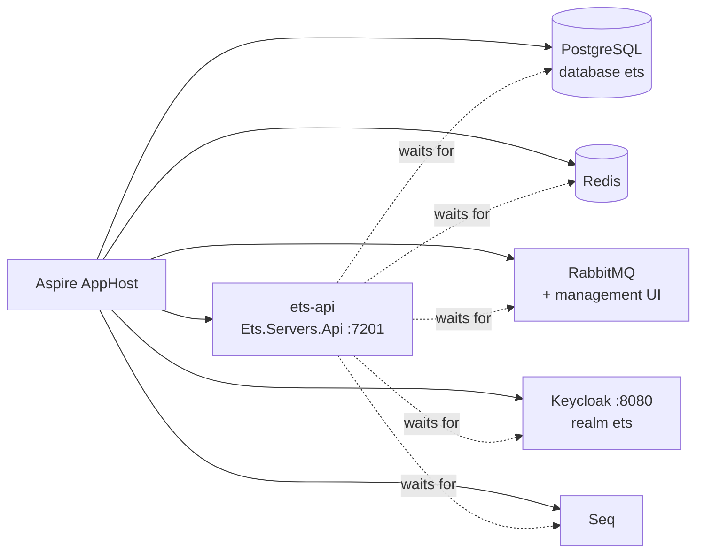

# Build and run

Run every command from the repository root unless it says otherwise. Make sure Docker is running first.

## Build the backend

```bash
dotnet build ets.slnx
```

The analyzers run as part of the build; keep it warning-clean.

## Build the frontends

::: code-group

```pwsh [PowerShell]
cd src\clients
pnpm install      # first time, and after any package.json or lockfile change
pnpm build        # vue-tsc type check, then vite build, for every @ets/app-* app
```

```bash [bash]
cd src/clients
pnpm install      # first time, and after any package.json or lockfile change
pnpm build        # vue-tsc type check, then vite build, for every @ets/app-* app
```

:::

The ETS web app builds to `src/clients/apps/ets/dist/`, a static site.

`pnpm install` runs install scripts only for the packages approved under `allowBuilds` in `pnpm-workspace.yaml`
(`esbuild` and `vue-demi`). If pnpm asks you to approve builds, you are probably running a pnpm that ignores the
pinned version: check `pnpm -v` inside `src/clients` (see [Prerequisites](./prerequisites#node-js-and-pnpm)).

## Run locally

You need two terminals: one for the backend and its dependencies, one for the web app.

### 1. Start the AppHost

::: code-group

```pwsh [PowerShell]
aspire run
# or, without the Aspire CLI:
dotnet run --project src\aspire\Ets.Aspire.AppHost
```

```bash [bash]
aspire run
# or, without the Aspire CLI:
dotnet run --project src/aspire/Ets.Aspire.AppHost
```

:::

The AppHost (`src/aspire/Ets.Aspire.AppHost/AppHost.cs`) starts the backing services as containers, then the API
once they are all up:



Open the Aspire dashboard from the link the AppHost prints (it carries the dashboard's sign-in token; `dotnet run`
also opens it in your browser) and wait until every resource is running.

::: info The first start is slow
The first start pulls the container images and takes a few minutes. Keycloak imports the local realm from
`src/aspire/Ets.Aspire.AppHost/Realms/ets-realm.json` on that first start only. The containers are
**persistent**, so later starts are quick and keep their data; the AppHost also keeps their ports and generated
passwords in its user secrets, so they stay the same between runs.
:::

### 2. Start the web app

::: code-group

```pwsh [PowerShell]
cd src\clients
pnpm dev
```

```bash [bash]
cd src/clients
pnpm dev
```

:::

### 3. Sign in

Open <http://localhost:5300> and sign in through Keycloak as the local test user **`trader` / `trader`**. In
Development the API seeds that user with the `Trader` and `Administrator` roles (`Users:DevelopmentSeed` in
`src/hosts/Ets.Servers.Api/appsettings.Development.json`), so the Deals and Users screens are available.

The dev server proxies `/api` to the API on `https://localhost:7201`, so the API needs no CORS entry. Edits to `.vue` and `.ts`
files reload in place; restart `pnpm dev` after changing `vite.config.ts` or `.env.local`.

## Local URLs

| What                     | URL                                                                                  |
| ------------------------ | ------------------------------------------------------------------------------------ |
| ETS web app              | <http://localhost:5300>                                                              |
| API reference (Scalar)   | <https://localhost:7201/scalar/> — sign in as `trader` from its authentication panel |
| API health               | <https://localhost:7201/health> (ready) and <https://localhost:7201/alive> (live)    |
| Keycloak admin console   | <https://localhost:8080> — see below for the credentials                             |
| Aspire dashboard         | Printed by the AppHost (`https://localhost:17201` under `dotnet run`)                |
| Seq, RabbitMQ management | Linked from the resources in the Aspire dashboard                                    |
| UI showcase              | <http://localhost:5303>, after `pnpm showcase` in `src/clients`                      |
| This docs site           | <http://localhost:5173>, see [The developer docs site](./developer-docs)             |

The Keycloak admin user is `admin`. Its password is generated on the first run and kept in the AppHost's user
secrets as `Parameters:keycloak-password`, and the dashboard shows it among the `keycloak` resource's parameters.
To print every generated secret:

::: code-group

```pwsh [PowerShell]
dotnet user-secrets list --project src\aspire\Ets.Aspire.AppHost
```

```bash [bash]
dotnet user-secrets list --project src/aspire/Ets.Aspire.AppHost
```

:::

## Configure the web app

The web app's defaults match the AppHost. To override them, copy `src/clients/apps/ets/.env.example` to
`.env.local` in the same folder and change what you need:

| Variable              | Default                             | Used for                                   |
| --------------------- | ----------------------------------- | ------------------------------------------ |
| `VITE_OIDC_AUTHORITY` | `https://localhost:8080/realms/ets` | The Keycloak realm the SPA signs in at     |
| `VITE_OIDC_CLIENT_ID` | `ets-web`                           | The realm's public PKCE client for the SPA |
| `VITE_OIDC_SCOPE`     | `openid profile email`              | The scopes the SPA requests                |
| `ETS_API`             | `https://localhost:7201`            | Where the dev server proxies `/api`        |

::: warning Fixed ports
Port `5300` is fixed (`strictPort`) because `http://localhost:5300/auth/callback` is the redirect URI registered on
the `ets-web` Keycloak client, and Keycloak's port `8080` is fixed so the token issuer is the same URL for the
browser and the API. Do not change either to work around a clash; stop the other process instead.
:::

## Next

[Set up the database](./database), or go to [Tests and code quality](./tests-and-quality).
