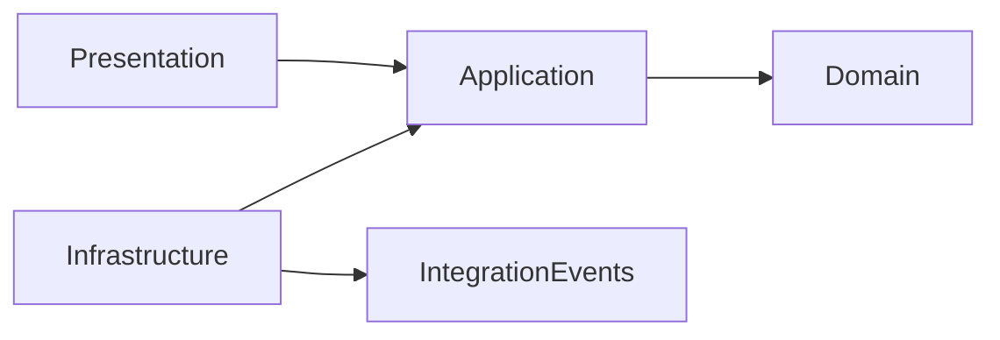

# Project layout

ETS is one repository holding a .NET solution, the domain model it is built from, and a pnpm workspace of
frontends. This page is a map; the reasons behind the shape are in the design documents listed on
[Next steps](./next-steps).

## The top level

| Path                       | What lives there                                                                   |
| -------------------------- | ---------------------------------------------------------------------------------- |
| `ets.slnx`                 | The .NET solution — open this one in your IDE                                      |
| `global.json`              | The pinned .NET SDK and Aspire AppHost SDK                                         |
| `Directory.Packages.props` | Every NuGet version (Central Package Management)                                   |
| `Directory.Build.props`    | Settings every project shares: `net10.0`, nullable, analyzers                      |
| `aspire.config.json`       | Tells `aspire run` which AppHost to start                                          |
| `src/core/`                | The shared kernel, `Ets.Core.*`                                                    |
| `src/modules/{module}/`    | One folder per module, `Ets.Modules.{Module}.*`                                    |
| `src/hosts/`               | The composition roots, `Ets.Servers.*` — today the one API host, `Ets.Servers.Api` |
| `src/aspire/`              | Local orchestration: the AppHost and the service defaults every host uses          |
| `src/clients/`             | The frontends: a pnpm workspace of `@ets/*` packages                               |
| `tests/`                   | xUnit v3 test projects, including the architecture tests                           |
| `modelling/ddd/`           | The domain model in Context Mapper (`*.cml`) and each context's `ubiquitous.md`    |
| `docs/architecture/`       | The architecture overview, the kernel contract and the ADRs                        |
| `src/CONTEXT.md`           | The domain glossary, invariants and known gaps                                     |
| `CLAUDE.md`                | The working rules for AI coding agents — also a dense summary of every convention  |

## The backend

The backend is a **modular monolith**: one API host composed of modules, each owning one bounded context of the
trading domain (Deals, Users, and later Settlement and Risk). It is built **model first**: the domain is designed in
the CML under `modelling/ddd/`, and the C# domain code reflects it. When the two disagree, the CML wins.

Every module is five projects with a fixed reference graph, which the architecture tests enforce:

```text
src/modules/deals/
  Ets.Modules.Deals.Domain/             aggregates, value objects, domain events, repository ports
  Ets.Modules.Deals.Application/        commands, queries, handlers, validators
  Ets.Modules.Deals.Infrastructure/     persistence, messaging, scheduling; the service-side composition root
  Ets.Modules.Deals.Presentation/       one endpoint class per slice; the route-side composition root
  Ets.Modules.Deals.IntegrationEvents/  the module's public API: events, snapshots, permission names
```



Another module, or the host, may reference only a module's `IntegrationEvents`; the host also references its
Infrastructure and Presentation to compose it, never its Application or Domain.

The tests mirror the source tree:

| Path                                      | Covers                                       |
| ----------------------------------------- | -------------------------------------------- |
| `tests/architecture/EtsArchitectureTests` | Module boundaries, layering and naming rules |
| `tests/core/EtsCoreTests`                 | The shared kernel                            |
| `tests/modules/{module}/Ets{Module}Tests` | One module                                   |

## The frontends

`src/clients` is the root of a pnpm workspace, kept separate from the .NET solution above it.

| Path                     | Package                   | What it is                                                             |
| ------------------------ | ------------------------- | ---------------------------------------------------------------------- |
| `apps/ets`               | `@ets/app-ets`            | The ETS web app (Vue 3 SPA); module screens in `src/modules/{module}/` |
| `apps/ui-showcase`       | `@ets/app-ui-showcase`    | A showcase of the `@ets/ui` components                                 |
| `apps/developer-docs`    | `@ets/app-developer-docs` | This site (VitePress)                                                  |
| `packages/ui`            | `@ets/ui`                 | Shared UI components on `@vuetify/v0`, with no domain vocabulary       |
| `packages/brand`         | `@ets/brand`              | Design tokens, fonts and logos, framework-free                         |
| `packages/editor`        | `@ets/editor`             | Opt-in Monaco code editors and sanitised markdown                      |
| `packages/tsconfig`      | `@ets/tsconfig`           | Shared TypeScript configuration                                        |
| `packages/eslint-config` | `@ets/eslint-config`      | Shared ESLint configuration                                            |

`apps/*` are deployables; `packages/*` are shared, never deployed, and have no build step — apps consume their raw
`.ts`, `.vue` and `.css` source. Versions that must agree across packages live in the `catalog:` of
`pnpm-workspace.yaml`. Read `src/clients/CONTEXT.md` before adding a package or changing how styles are shared.

## Next

[Open the solution in your IDE](./ide).
